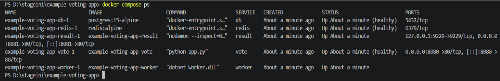
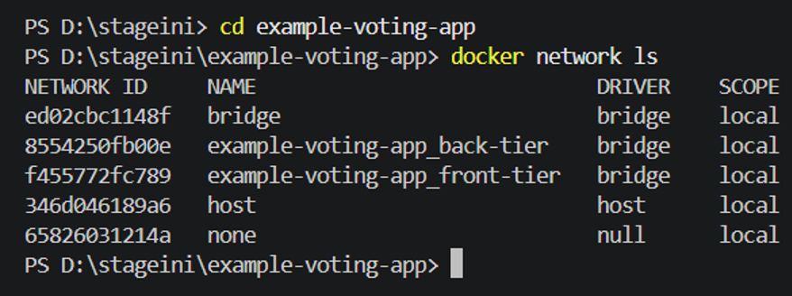

# Docker Network Security Hardening

A network security hardening project based on the [Docker Example Voting App](https://github.com/dockersamples/example-voting-app).

The project focuses on improving the network architecture and security configuration of a multi-container application through network segmentation, Nginx reverse proxy, traffic rate limiting, and Docker firewall rules.

> **Project scope:** The original voting application is based on Docker's Example Voting App. This project focuses on its security architecture and configuration.

## Objectives

- Segment application services into dedicated Docker networks.
- Expose a single public entry point through Nginx.
- Apply HTTP request rate limiting.
- Restrict HTTP methods at the reverse proxy.
- Define explicit firewall rules for required inter-service traffic.
- Run application containers with non-root users where configured.
- Validate selected network communication paths.

## Architecture

The application is organized into three Docker bridge networks.

| Network | Subnet | Services |
|---|---|---|
| `fr-net` | `172.20.1.0/24` | Nginx, Vote, Result |
| `bk-net` | `172.20.2.0/24` | Redis, Worker |
| `db-net` | `172.20.3.0/24` | PostgreSQL |

### Network addressing

| Service | Network | IP address |
|---|---|---|
| Nginx | fr-net | `172.20.1.10` |
| Vote | fr-net | `172.20.1.20` |
| Result | fr-net | `172.20.1.30` |
| Redis | bk-net | `172.20.2.10` |
| Worker | bk-net | `172.20.2.20` |
| PostgreSQL | db-net | `172.20.3.10` |

The database network is configured with Docker's `internal: true` option.


## Security measures

### 1. Nginx reverse proxy

Nginx acts as the application's public entry point. Only its HTTP port is published on the host:

- `/vote/` routes requests to the Vote service.
- `/result/` routes requests to the Result service.
- `/` redirects users to `/vote/`.

The Vote and Result services do not publish host ports.

### 2. HTTP request rate limiting

Nginx applies request rate limits based on the client's IP address:

- Vote: `10 requests/second`
- Result: `10 requests/second`
- Burst allowance: `20 requests`

The configured rate limits apply to the corresponding `/vote/` and `/result/` locations.

### 3. HTTP method restriction

The Nginx server accepts only:

- `GET`
- `POST`

Other HTTP methods receive `405 Method Not Allowed`.

### 4. Network segmentation and firewall rules

The `DOCKER-USER` chain is used to define explicit allow rules for the required service communication:

| Source | Destination | Protocol | Port |
|---|---|---|---|
| Vote | Redis | TCP | 6379 |
| Worker | PostgreSQL | TCP | 5432 |
| Result | PostgreSQL | TCP | 5432 |

An additional rule accepts established and related connections.

**Firewall scope:** These rules explicitly allow the listed traffic. They do not constitute a global default-deny policy for all other traffic.

### 5. Container execution

The Compose configuration specifies non-root user IDs for Vote, Result, Redis, and Worker (`999:999`).

## Validation

The project includes documentation of the initial architecture, network segmentation, security measures, and firewall validation.

Recorded observations include:

- Successful Vote-to-Redis TCP connectivity.
- A failed connection attempt from a temporary frontend test container to Redis.
- Firewall rule counters observed for the configured database communication paths.

These observations are documented with their limitations; firewall counters alone do not prove successful database transactions.

## Project documentation

- [Initial architecture](documentation/before-security.md)
- [Network segmentation](documentation/network-segmentation.md)
- [Security measures](documentation/security-measures.md)
- [Firewall validation](documentation/firewall-validation.md)

## Screenshots

Initial application containers:



Initial Docker networks:



## Technologies

- Docker and Docker Compose
- Docker bridge networks
- Nginx
- Linux iptables
- Docker Desktop / WSL2
- PostgreSQL
- Redis

## Running the project

### Prerequisites

- Docker Desktop
- Docker Compose
- Git

### 1. Clone the repository

```bash
git clone https://github.com/fatimazahra0677/docker.git
cd docker
```

### 2. Configure environment variables

Create a local `.env` file containing the required `DB_PASSWORD` variable.

Never commit `.env` or publish database credentials.

### 3. Validate the Compose configuration

```bash
docker-compose -p example-voting-app config --quiet
```

### 4. Start the application

```bash
docker-compose -p example-voting-app up -d
```

### 5. Check running containers

```bash
docker-compose -p example-voting-app ps
```

Open the application at:

`http://localhost/`

### 6. Stop the application

```bash
docker-compose -p example-voting-app down
```

The `firewall-init` service uses privileged host namespace access to initialize iptables rules. This implementation is specific to the Docker Desktop/WSL2 lab environment and requires security review before use elsewhere.

## Future improvements

- Implement and validate a comprehensive default-deny firewall policy.
- Expand connectivity tests for all service communication paths.
- Automate security validation.
- Review container capabilities and privileges.
- Evaluate production-ready firewall management.