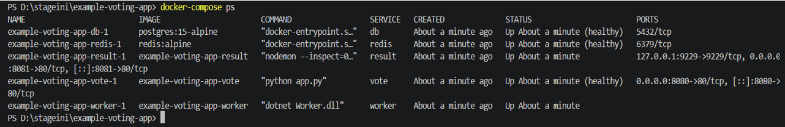
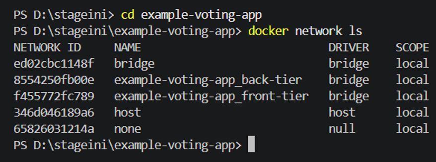

# Initial Architecture – Before Security Implementation

## 1. Project Context

The project is based on the Example Voting App, an existing multi-container application retrieved from GitHub.

The application consists of several services:

- **Vote:** collects votes from users.
- **Redis:** temporarily stores submitted votes.
- **Worker:** processes votes and transfers the data.
- **PostgreSQL:** stores application data.
- **Result:** displays voting results.

The initial application was used as a starting point for a network and infrastructure security improvement project.

## 2. Initial Security Assessment

The initial architecture was examined to identify potential security weaknesses and unnecessary network exposure.

The main areas investigated were:

- Network segmentation between application services.
- Exposure of container ports on the Docker host.
- Access control between containers.
- Network traffic filtering.
- HTTP request management.
- Container execution privileges.

## 3. Security Issues to Investigate

The assessment focused on the following potential risks:

| Area | Potential weakness |
|---|---|
| Network architecture | Insufficient network segmentation |
| Port exposure | Direct publication of application service ports |
| Inter-container communication | Unrestricted or insufficiently controlled traffic |
| Firewall | Absence of specific filtering rules |
| HTTP requests | No request rate limiting |
| Container security | Potential use of excessive execution privileges |

## 4. Security Objectives

The security improvement project aimed to:

1. Introduce network segmentation.
2. Restrict unnecessary inter-container communication.
3. Control access to application services through Nginx.
4. Apply request rate limiting.
5. Restrict unnecessary HTTP methods.
6. Improve container execution security.

## 5. Scope

This project focuses on improving the network architecture and security configuration of an existing Docker-based application.

The original application was retained as the functional foundation. The security configurations and validation procedures represent the main technical contribution of this project.

**Note:** The identified weaknesses must be confirmed against the original Docker configuration and runtime environment before being described as verified vulnerabilities.

## 6. Initial Environment Inspection

### Running Containers

The `docker compose ps` command was used
to inspect the status of the application containers.

### Docker Networks

The `docker network ls` command was used
to inspect the Docker networks available
in the initial environment.

